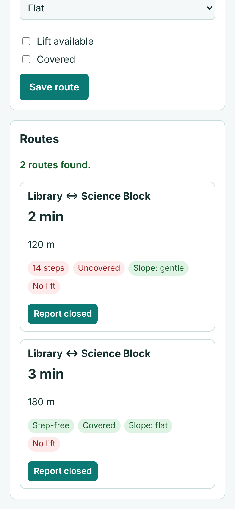
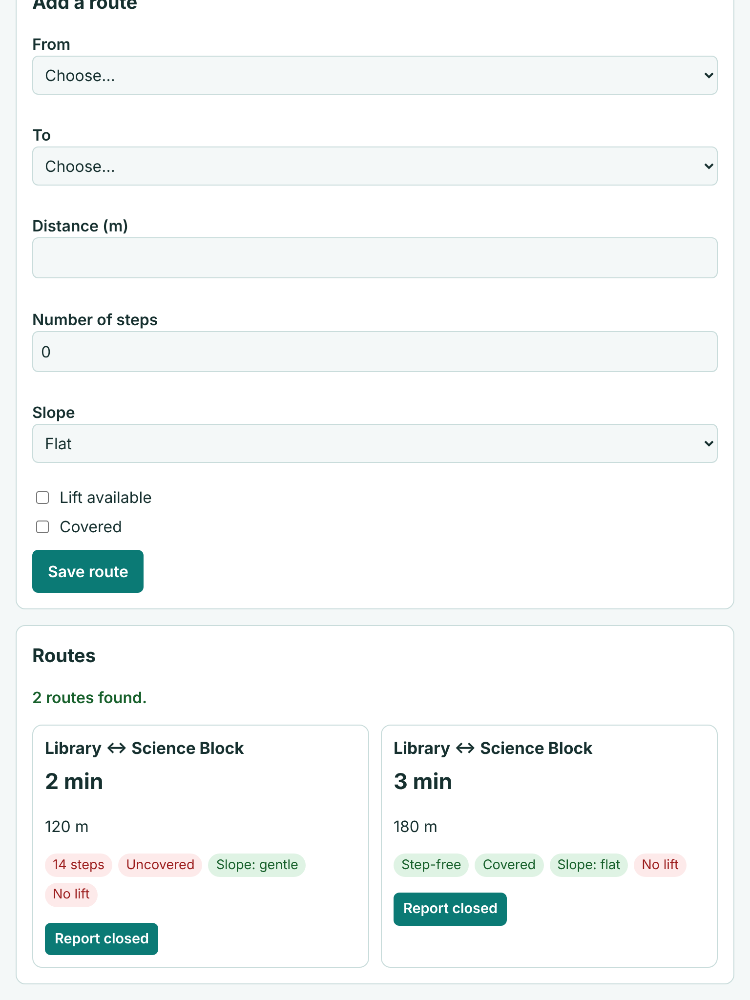
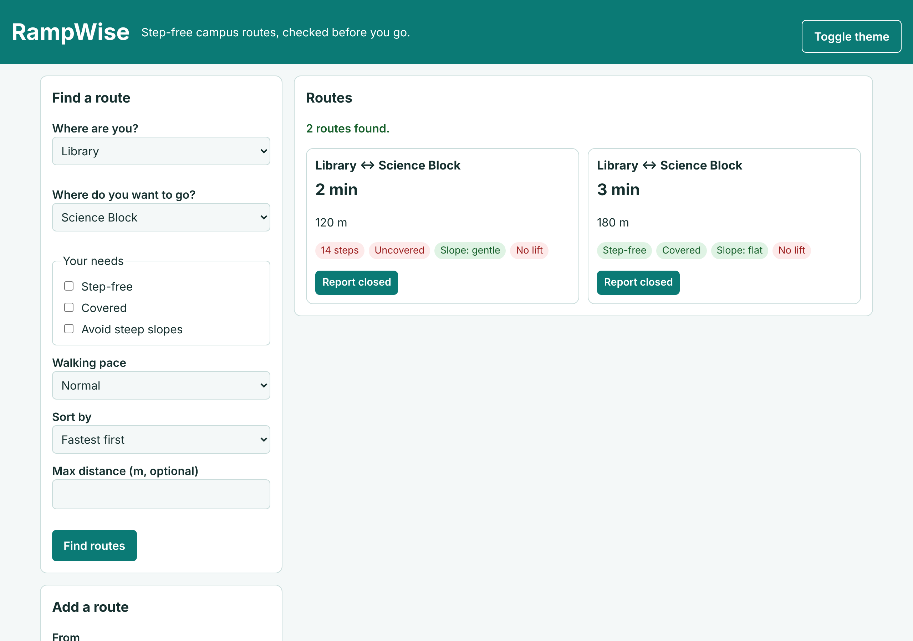
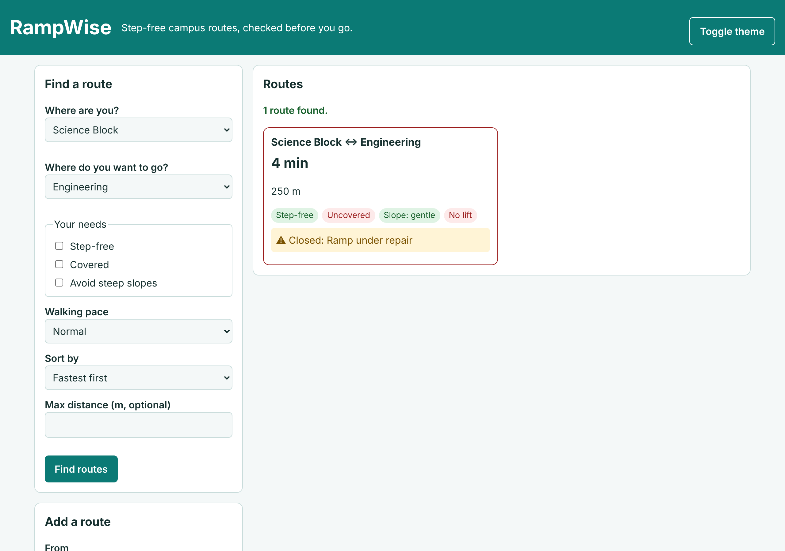
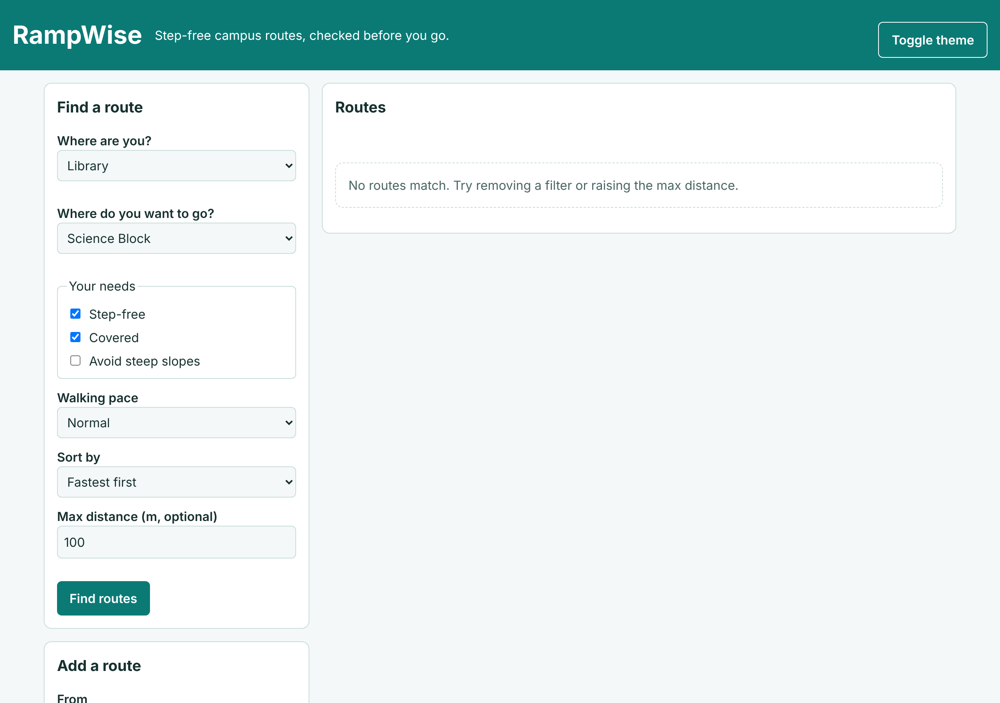
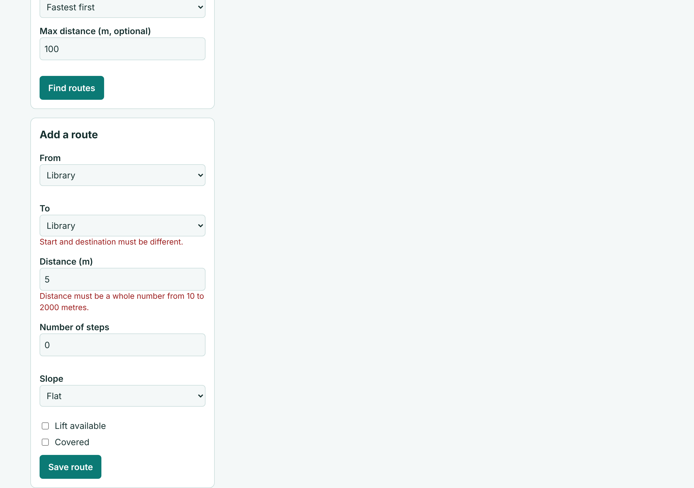

# RampWise: Accessible Campus Route Planner (Assignment 2: PHP and Fetch)

**Assigned idea:** #18 Accessible Campus Route Planner (route segments, accessibility attributes, temporary closures and user-selected mobility constraints)

**Author:** Nida Shah  **CMS ID:** 507819

**Submitted to:** Dr. Muhammad Khuram Shahzad

**Course:** CS-344-Web Engineering B 2K24-BESE-15


## User and problem
A student or visitor with a mobility need (wheelchair, crutches, low stamina, stroller) must get between campus buildings. Normal maps do not show steps, steep slopes or broken lifts. The planner filters routes by those needs and shows travel time and warnings. Assignment 2 keeps the same user, records and look, and adds a server and database so routes and closure reports are saved and shared instead of lost on reload.

## Run it
Needs PHP 8.2 or newer (written for 8.5) with the `pdo_sqlite`, `mbstring` and `curl` extensions enabled. No other libraries or build step.

```bash
git clone https://github.com/nidashah612/rampwise-campus-route-planner.git
cd rampwise-campus-route-planner
php db/seed.php --reset          # creates db/rampwise.sqlite (6 buildings, 10 routes)
php -S localhost:8000 -t public  # start the server
```
Then visit http://localhost:8000. To run the tests, keep the server running and in a second terminal use `php tests/run_tests.php`.
Live URL: runs locally and is demonstrated in class. Assignment 1 (client-side) is still live at https://nidashah612.github.io/rampwise-campus-route-planner/

## Features
* Route finder: filters by building pair, step-free, covered, steep slope and maximum distance; sort by fastest or most accessible; results show time at the chosen pace. Filtering and time are now calculated on the server.
* Add, edit and delete your own routes (full CRUD). Seeded routes are read-only.
* Report a blocked route: saved in the database with a reason and shown as closed with a warning. The reporter or route owner can reopen it.
* Fetch with async/await and JSON: loading, success, empty and error states without page reloads.
* Server-side validation with a message under each field, plus prepared statements (PDO), output encoding, session ownership and a CSRF token on every write.
* Edge cases: empty selection, same start and destination, no matches, closed routes, invalid distance, too-short report reason.
* Responsive: mobile (default), tablet (600px), desktop (1024px). Browser storage keeps only the light/dark theme.

## Client vs server
The browser only collects input, calls the JSON endpoints with `fetch` and draws the results. The PHP server validates every request, checks the session and CSRF token, runs the PDO queries on SQLite and returns JSON. The data is no longer held in `data.js`; it lives in the database.

| File | Purpose |
|---|---|
| `db/schema.sql`, `db/seed.php` | Schema and seed data |
| `lib/bootstrap.php` | Session, CSRF, PDO, JSON helpers, validation |
| `public/api/routes.php` | Search, create, update, delete routes |
| `public/api/report.php` | Report a route closed or reopen it |
| `public/api/buildings.php` | Building list |
| `public/index.php`, `app.js`, `style.css` | Interface |
| `tests/run_tests.php` | Automated tests |

## Tests
Run `php tests/run_tests.php`. It uses two separate sessions and covers: missing input (422), invalid input (422), SQL-style input (422), a successful create and update (201, 200), editing or deleting someone else's or a seeded route (403), a write without a CSRF token (403), sorting by an unknown value (422), a too-short report reason (422), a report containing `<script>` and a reopen by a non-reporter (403).

## WDLC summary
Planning (same user and scope), analysis (add persistence, ownership and security needs), design (schema, JSON contract, same wireframe), implementation (SQL schema, PHP endpoints, Fetch UI), testing (automated and manual cases above), deployment (GitHub, run locally with `php -S`), maintenance (add accounts and an admin role in Assignment 3).

## Screenshots

| Mobile (390 px) | Tablet (768 px) | Desktop (1280 px) |
|---|---|---|
|  |  |  |

| Closed route warning | Empty state | Server-side validation error |
|---|---|---|
|  |  |  |

Report: `docs/Assignment2-Report.docx`. Mobile form view: `docs/mobile-form.png`.

## Limitations
The app only has direct routes between two buildings, so it cannot plan a trip with a stop in the middle. There is no login (identity is an anonymous session), and closures have no end date: a route stays closed until it is reopened.

## AI assistance disclosure
Anthropic's Claude was used only to generate the initial draft, which I have fully reviewed, tested, and understood. Contains fictional sample data only—no real credentials or private data included.


## Attribution
No third-party libraries, frameworks, images or templates. All sample data is invented. No credentials or private data are included; the database file is excluded by `.gitignore`.
